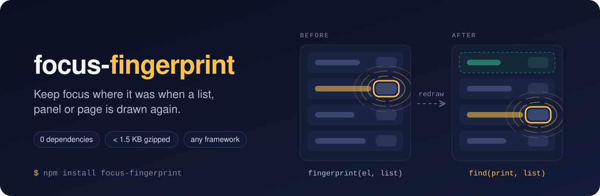

# focus-fingerprint

[](https://www.npmjs.com/package/focus-fingerprint)
[](https://github.com/sorena-labs/focus-fingerprint/actions/workflows/ci.yml)
[](LICENSE)

Find the element that had focus again after its part of the page is drawn again, so focus goes back to it instead of falling to the `body`.

```ts
const print = fingerprint(document.activeElement, list);
// ...the list is drawn again, and every node in it is new...
restore(print, list);
```

No dependencies. Under 1.5 KB gzipped. Works with any framework, or none.

## The problem

A list is fetched again. A router swaps a screen. A keyed component remounts. A row is deleted. Each time, the element that had focus is replaced by a new node, or removed. The browser moves focus to the `body`, and:

- a keyboard user presses Tab and starts again from the top of the page,
- a screen reader user hears nothing, and must find their place again,
- someone typing in a field that is drawn again loses their caret in the middle of a word.

Accessibility audits flag this under WCAG 2.4.3, Focus Order. It is easy to miss, because a mouse user never sees it.

The usual fixes each break somewhere:

| What you store before the redraw | Where it breaks |
| --- | --- |
| The element itself | It is detached afterwards. Calling `focus()` on it does nothing. |
| Its id | Most buttons and links have no id. Generated ids can change on remount. |
| A selector or an index | A row added above, removed above or sorted puts another row's button in that place, and focus lands on the wrong one. |
| Nothing, and focus a heading instead | Focus is safe, but people lose their place in the list. |

Dialog and focus trap libraries give focus back to the element that opened them. When the page behind the dialog was drawn again while it was open, that element is detached, and they cannot.

## Why use focus-fingerprint

`fingerprint` records several things about the element: the element itself, its id, the key of its row, where it sits inside a root, its tag and its name. `find` tries them from the most certain to the least, and every candidate must have the same tag and name. So:

- **You get the same element, or nothing.** When two elements look the same, `find` returns `undefined` instead of guessing, and you choose the fallback.
- **Rows can move.** With `key: "data-key"`, a row is found by its key after rows are inserted, removed or reordered.
- **Deleted elements have a place to go.** With `{ fallback: true }`, `find` gives the next row, then the one before it, then the list itself, the way focus moves in a native app when you delete an item.
- **The caret comes back.** `restore` puts the caret and selection back in an `<input>` or `<textarea>` that was drawn again while someone typed.
- **It never picks what cannot take focus.** Disabled elements, and elements under `inert` or `aria-hidden="true"`, never count.
- **A stored fingerprint is safe to keep.** It holds the old element weakly, so it does not keep the old page in memory.
- **It works where your DOM is.** React, Vue, Svelte, Angular, Lit, htmx or plain DOM: it reads elements, not components. Shadow roots work too.
- **It stays out of your way.** Three functions, no dependencies, TypeScript types included, and nothing runs until you call it, so it is safe to import on the server.

## Install

```bash
npm install focus-fingerprint
```

The package is ESM only.

## Quick start

Three steps: record what has focus, draw again, give focus back.

```ts
import { fingerprint, restore } from "focus-fingerprint";

const list = document.querySelector<HTMLElement>("#results")!;

async function refresh() {
  // 1. Record what has focus inside the list. Undefined when focus is somewhere else.
  const print = fingerprint(document.activeElement, list, { key: "data-key" });

  // 2. Draw the list again: every row is a new <li data-key="...">.
  list.replaceChildren(...(await renderRows()));

  // 3. Give focus back. If the element is gone, focus the list (give it tabindex="-1").
  if (print) restore(print, list) ?? list.focus({ preventScroll: true });
}
```

Check `print` before you fall back, so you do not take focus from somewhere else on the page.

## Recipes

### A deleted row, in React

When the row that has focus is deleted, `{ fallback: true }` moves focus to the row that took its place:

```tsx
import { useLayoutEffect, useRef } from "react";
import { find, fingerprint, type Fingerprint } from "focus-fingerprint";

function Inbox({ rows, onArchive }: { rows: Row[]; onArchive: (id: string) => void }) {
  const list = useRef<HTMLUListElement>(null);
  const print = useRef<Fingerprint | undefined>(undefined);

  const archive = (id: string) => {
    print.current = fingerprint(document.activeElement, list.current, { key: "data-key" });
    onArchive(id);
  };

  useLayoutEffect(() => {
    // The next row, else the previous row, else the list itself once it is empty.
    find(print.current, list.current, { fallback: true })?.focus({ preventScroll: true });
    print.current = undefined;
  }, [rows]);

  return (
    <ul ref={list} tabIndex={-1} aria-label="Inbox">
      {rows.map((row) => (
        <li key={row.id} data-key={row.id}>
          {row.subject}
          <button aria-label={`Archive ${row.subject}`} onClick={() => archive(row.id)}>Archive</button>
        </li>
      ))}
    </ul>
  );
}
```

Each button has its own name, so `find` alone returns `undefined` once its row is gone, and the fallback picks the next row's button. `useLayoutEffect` runs before the browser paints, so nobody sees focus on the `body` in between.

### A text field drawn again while someone types

`restore` puts the caret and selection back too:

```ts
const search = fingerprint(document.activeElement, form, { name: (el) => el.getAttribute("name") ?? "" });

// ...the form is drawn again...

if (search) restore(search, form);
```

An element's default name is its `aria-label`, or else its text. A `<textarea>` drawn again can have different text from the one recorded, so match text fields on something that stays the same, such as their `name` attribute.

### Back to the opener of a dialog

When saving in a dialog draws the table behind it again, the button that opened the dialog is a new node by the time the dialog closes. Record it when the dialog opens, and restore it after the dialog closes. If your dialog library gives focus back on its own, turn that off, or call `restore` after it:

```ts
const opener = fingerprint(document.activeElement, table, { key: "data-key" });

await editInDialog(row); // Saving draws the table again.

if (opener) restore(opener, table) ?? table.focus({ preventScroll: true });
```

## How `find` decides

It returns the first of these that is there, or `undefined`:

1. The element itself, while it is still connected, inside `root`, not disabled, and not under `inert` or `aria-hidden="true"`. A disabled element (`:disabled`, which includes one inside a disabled `<fieldset>`) cannot take focus, so it does not count. One with `aria-disabled="true"` can, so it does.
2. The element in `root` with the same id, if it has the same tag and name and is usable.
3. With `options.key`, the element at the same index path from the row in `root` with the same key, if it has the same tag and name and is usable.
4. The element at the same index path from `root`, if it has the same tag and name and is usable.
5. The only usable element anywhere in `root` with the same tag and name, so a row added above it or a list sorted again still finds it. When two or more match, `find` does not guess.
6. Only when `options.fallback` is `true`, the element nearest to where it was. From the deepest level of the old index path that is still there up to `root`, it tries the sibling now at the old index (the next item, moved up), then the one before it (for when the old item was last). For each in turn, it returns the sibling itself if it is usable and can take focus, or else the first usable element inside it that can. Else `root` itself, if it is usable.

An element can take focus here when it has a `tabindex`, or is a link with an `href`, a button, an input, a select or a textarea.

## API

### `fingerprint(el, root, options?)`

Records `el`, which must be inside `root`. Returns a `Fingerprint`, whose contents are private, or `undefined` when `el` is missing, is `root` itself, or is not inside `root`.

- `el`: `Element | null | undefined`, usually `document.activeElement`.
- `root`: `Element | null | undefined`, the part of the page that will be drawn again.
- `options.name`: `(el: Element) => string`, the name an element must keep to count as the same element. Defaults to its `aria-label`, or else its text, trimmed. Pass your own to match on something else, such as a `data-` attribute.
- `options.key`: `string`, an attribute, such as `data-key`, that gives each row of a list a value that stays the same when the list is drawn again. The nearest element from `el` up to `root` with a non-empty value is the row. Keys should be unique inside `root`. Without a key or an id, a row inserted above, removed above or moved can put another row's button with the same name at the recorded index path, and `find` returns that one.

For an `<input>` or `<textarea>`, it also records the caret and selection: `selectionStart`, `selectionEnd` and `selectionDirection`. An input with no caret, such as a checkbox, records none.

### `find(print, root, options?)`

Returns the recorded element, or the one that replaced it, as described in [How `find` decides](#how-find-decides). Returns `undefined` when `print` or `root` is missing, or nothing matches.

- `print`: `Fingerprint | undefined`, from `fingerprint`.
- `root`: `Element | null | undefined`. It may be the same node as before or a new one.
- `options.fallback`: `boolean`. When `true`, return the element nearest to where it was instead of `undefined`.

The name is read with the same function the fingerprint was taken with. The return type is `HTMLElement | SVGElement`: both have `focus()`. `find` does not move focus. An element that is not focusable, such as `root`, needs `tabindex="-1"` before you focus it.

### `restore(print, root)`

Calls `find(print, root)`, focuses what it returns with `preventScroll: true`, and returns it, or `undefined` when there is nothing to focus.

When `find` returned a new `<input>` or `<textarea>` in place of the recorded one, `restore` also puts back the caret and selection the fingerprint recorded. A position past the end of the new value moves to its end. When `find` returned the recorded element itself, its own caret is left alone. Elements with `contenteditable` get focus but not their caret back.

`restore` has no `fallback` option. To fall back, call `find(print, root, { fallback: true })` and focus what it returns.

### Types

`Fingerprint`, `FingerprintOptions` and `FindOptions` are exported for TypeScript.

## Browser support

Any browser with `WeakRef`: Chrome 84, Firefox 79, Safari 14.1, and later. It also runs in jsdom, so it works in your tests.

## Contributing

Bug reports and pull requests are welcome. See [CONTRIBUTING.md](CONTRIBUTING.md), and the [changelog](CHANGELOG.md) for what changed in each release.

## Licence

[MIT](LICENSE)
